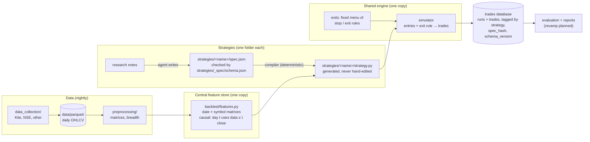

# Trading Research Platform

A research platform for Indian equities (NSE). It collects market data every day, builds derived datasets from
it, scans for momentum setups (Stockbee / Qullamaggie style), tests ideas with backtests, and shows the result
in a web dashboard.

**It never places orders.** It prepares order tickets and plans; you punch them in by hand.
This is research software, not financial advice. Market data is **not** in this repository.

## How it fits together

Code lives in `src/`, one folder per layer, listed here from the bottom up. A layer imports from the ones above it in
this table and not from those below, with a few known exceptions inside `backtest/` (`preprocessing` borrows one
function from it, and the one-off studies in `backtest/studies/` import from several layers).

| Layer | What it does |
|---|---|
| `data_collection/` | Fetches data from outside: `kite/` (needs a Kite login), `nse/` and `other/` (free). Imports nothing from the other layers. |
| `preprocessing/` | Builds derived datasets from collected data (summary table, price matrices, market breadth). |
| `indicators/` | Pure calculations on price and volume series: moving averages, ADR, relative strength. No file access. |
| `filters/` | Standalone True/False scan conditions built on indicators. |
| `risk/` | The market risk dial, position sizing, and the daily plan gates. |
| `scanners/` | Finds candidates, ranks them, builds order tickets; also the live intraday scanner. |
| `execution/` | Account snapshot, paper trading, and the order plan/preview module. |
| `evaluation/` | Grades past decisions with forward returns and reads out the forward-test record. |
| `backtest/` | Point-in-time backtest engine and the older studies (`backtest/studies/`). |
| `pipeline/` | The nightly job. The only layer that calls all the others. |
| `experimentation/` | One-off studies. Nothing in production imports from here (a test enforces it). |

Each layer folder has its own `README.md` listing its modules.

## System architecture

Keep this section current. Any change to layers, folders or the pipeline updates it in the same PR.



How it works:

1. **Features are computed once.** Every feature lives in the central feature store and every strategy reuses it. A strategy never computes its own indicator. If a spec needs a new feature, the feature is added to the store first.
2. **A strategy is a JSON spec.** It lives at `strategies/<name>/spec.json` and must pass the versioned schema in `strategies/_spec/`. A schema change bumps `schema_version` and adds a line to the schema's CHANGELOG.
3. **The Python file is generated.** A deterministic compiler turns each spec into `strategy.py`, so the same spec always produces the same code. An agent writes specs, not code.
4. **One engine runs every strategy.** It writes entries and exits into one trades database. Each run stores the full spec it used, so every trade traces back to the exact rules that produced it.
5. **Results are rebuilt, not shared.** `output/trades.duckdb` is a local cache that is never committed. Each person rebuilds it from the specs in git and their copy of the data snapshot. When two people's results differ, compare `spec_hash`, `git_sha` and `data_snapshot` first. The steps are in `.claude/skills/rebuild-trades/SKILL.md`; the table layout and write rules are in `.claude/skills/trades-db/SKILL.md`.
6. **Old work is archived.** `strategies/_archive/` holds every earlier strategy and research folder. It is read-only, and the live scanners still import from it until replacements exist.

Status: the data layers and the feature store exist today. The schema, compiler, engine and trades database are being built (PRs 1, 2 and 4).

Other top-level folders:

| Folder | What it holds |
|---|---|
| `strategies/` | One folder per strategy (`spec.json` + generated `strategy.py`), the spec schema in `_spec/`, and every older strategy and research folder in the read-only `_archive/`. |
| `research/` | The research machine: genetic search, the regime lab, and the experiment factory. Read `research/README.md` first. |
| `webapp/` | The dashboard: FastAPI server (`server/`) and React front end (`frontend/`). |
| `launchers/` | Double-click macOS scripts for the token refresh, manual update and dashboards. |
| `Docs/` | Plain-English references: what every scan computes, strategy write-ups, study notes. |
| `data/`, `output/`, `logs/` | Not in git. Data, results and logs are created locally. |

## Getting started

You need Python 3.10 and, for the dashboard, Node 22. The maintainer uses Anaconda; the launchers and the cron
wrapper assume it lives at `~/anaconda3`.

```bash
git clone https://github.com/gauravk09/trading-research-platform.git
cd trading-research-platform
pip install -r requirements.txt
```

`requirements.txt` is incomplete. The code also imports `scipy` and `numba` (the market risk model), plus
`scikit-learn`, `matplotlib`, `reportlab`, `yfinance` and `pytest` (research tools and some studies). Install them too:

```bash
pip install scipy numba scikit-learn matplotlib reportlab yfinance pytest
```

**Kite access.** Daily prices come from Zerodha's Kite Connect API, so you need your own API key. Copy
`.env.example` to `.env` and fill in `KITE_API_KEY` and `KITE_API_SECRET`. Never commit `.env`.

**Data.** The `data/` folder is not in the repo. Ask the maintainer for the data snapshot (`.tar.gz` bundles) and
extract them at the repo root, so you get `data/parquet/` and `data/processed/`. It is shared privately; check the
Kite and NSE data terms before passing it on.

## Running things

Everything runs as a module from the repo root, with `PYTHONPATH=src`:

```bash
PYTHONPATH=src python -m data_collection.kite.auth      # refresh the Kite token (needed every morning)
PYTHONPATH=src python -m pipeline.run_daily             # the full nightly update
PYTHONPATH=src python -m pipeline.collect_all           # full history after a new IPO lists
PYTHONPATH=src python -m data_collection.nse.bulk_deals # any single collector
```

The Kite token expires every morning at 6 AM IST. If it is stale, the nightly update stops at its first step and
nothing refreshes.

**Automatic nightly run.** `src/eod_update_cron.sh` is the cron wrapper (8 PM IST on weekdays). Edit its `PROJECT`
and `PYTHON` lines to match your machine before scheduling it.

**Dashboard.** On macOS, double-click `launchers/dashboards/run_dashboard.command`. It needs
`npm --prefix webapp/frontend install` once. The page opens at http://localhost:5173 (API on 8700, live scanner on 8602).

**Tests.**

```bash
cd src && python -m pytest -q       # the layers
cd .. && python -m pytest webapp/server -q
```

## Read next

1. `ROADMAP.md`: what is built, what is next, and what was **rejected and why**. Check its Rejected section before proposing an idea.
2. `src/data_collection/README.md`: every dataset, which script collects it, and which feeds cannot be recovered if a day is missed.
3. `Docs/SCANS_REFERENCE.md`: what every scan computes.
4. `.claude/CLAUDE.md`: the project rules (written for the AI assistant the maintainer uses, but they apply to everyone).

## Things to know before trusting a result

- The stored universe only has stocks that still trade. Delisted names are missing, so small-cap results look better than they were.
- There is no historical ASM/GSM (surveillance) data, so backtests cannot exclude stocks that were restricted at the time.
- Some feeds exist only on the live day (FII/DII, bulk deals, stock open interest). A missed day is gone.
- Entry prices in backtests are approximated from daily bars.
- Treat older verdicts in the notes as hypotheses until you have re-checked them.
